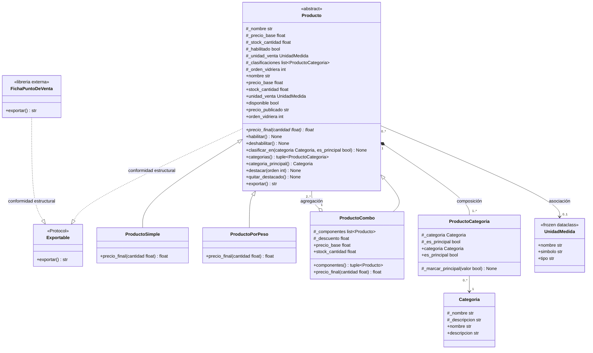

# Diagrama de Clases UML Final — Food Store

## 1. Diagrama de Clases (Mermaid)

---

## 2. Fundamentación de las Decisiones de Diseño

### 2.1 Decisión sobre `ProductoDestacado` (Requerimiento 3 / HU-P1-05)
En el diagrama de partida, `ProductoDestacado` figuraba como una subclase tentativa de `Producto` marcada «a revisar».

- **Criterio «es-un» del dominio:** Un producto destacado **no constituye un tipo de venta distinto** dentro del catálogo. La jerarquía de `Producto` especializa *cómo se comercializa y cómo calcula su precio final* (`ProductoSimple` por pieza, `ProductoPorPeso` por masa y `ProductoCombo` por agregación con descuento).
- **Problema de la herencia:** Si se mantuviera como subclase de `Producto`, un producto por peso (`ProductoPorPeso`) o un combo (`ProductoCombo`) no podrían destacarse en la vidriera sin recurrir a herencia múltiple artificiosa, y además requeriría inventar una regla de `precio_final()` ajena al rol de vidriera.
- **Rediseño implementado (Opción A2):** Se eliminó la clase `ProductoDestacado` de la jerarquía. El orden de vidriera se modeló como un atributo opcional `_orden_vidriera: int | None` en la clase base `Producto`, accesible mediante la property `orden_vidriera` y gestionado con los métodos `destacar(orden: int)` y `quitar_destacado()`. De este modo, **cualquier producto del catálogo** (simple, por peso o combo) puede promocionarse en vidriera sin distorsionar su tipo ni su regla de tarificación.

### 2.2 Decisión sobre `precio_base` y `stock_cantidad` en `ProductoCombo`
- **Semántica derivada (Opción B2):** En lugar de requerir datos redundantes y potencialmente inconsistentes en el constructor, `ProductoCombo` sobrescribe las properties `precio_base` y `stock_cantidad`.
- `precio_base` se calcula dinámicamente como la suma de `precio_final(1)` de sus componentes, lo que garantiza que `precio_publicado` refleje con fidelidad el valor sin descuento del combo.
- `stock_cantidad` se deriva como el valor mínimo entre los stocks de sus componentes, asegurando que `disponible` cambie a `False` si alguno de sus elementos se agota.

### 2.3 Relaciones Estructurales
- **Composición (`Producto` a `ProductoCategoria`, 1 a 1..*):** El vínculo nace y muere con el producto. El código cliente no puede instanciar `ProductoCategoria` directamente; se crea internamente mediante `Producto.__init__` y `Producto.clasificar_en()`.
- **Agregación (`ProductoCombo` a `Producto`, 1 a 2..*):** Los productos componentes existen independientemente antes y después del ciclo de vida del combo.
- **Asociación (`Producto` a `UnidadMedida`, 0..* a 0..1):** Las unidades de medida son inmutables y existen con total independencia de los productos que las referencien.
- **Conformidad Estructural (`Protocol` `Exportable`):** Ni `Producto` ni `FichaPuntoDeVenta` heredan de `Exportable`. Ambas satisfacen el contrato estructuralmente al proveer el método `exportar() -> str`.
